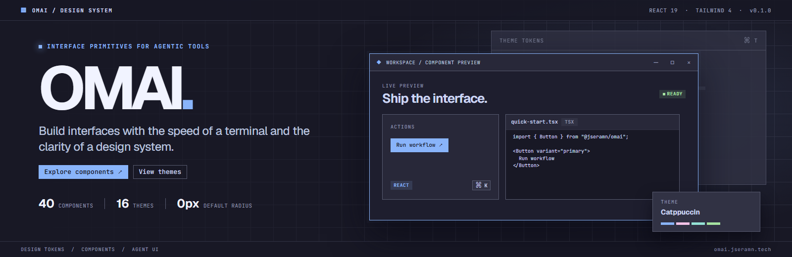

# OMAI — Omarchy Based Agent Interface

> A razor-sharp, keyboard-first web design system and agent interface library created by **[jseramn](https://github.com/jseramn/omai)** — inspired by and based on the visual language of [omarchy.org](https://omarchy.org) and [Omarchy OS](https://github.com/omacom/omarchy) (MIT License).

[](https://www.npmjs.com/package/@jseramn/omai)
[](https://www.npmjs.com/package/@jseramn/omai-tokens)
[](https://react.dev)
[](https://tailwindcss.com)
[](./LICENSE)
[](https://github.com/jseramn/omai/actions/workflows/ci.yml)
[](https://github.com/jseramn/omai/releases/latest)
[](https://omai.jseramn.tech)

Explore the interactive component catalogue at [omai.jseramn.tech](https://omai.jseramn.tech).

**OMAI (Omarchy Based Agent Interface)** translates the precision engineering of tiling Linux desktops into reusable, accessible web and agent UI primitives. It pairs Geist sans headings, JetBrains Mono body typography, razor-sharp `0px` corners, `1px` hairlines, and flat elevation with desktop-grade interactive components: Hyprland-style tiling grids, 26px Waybars, Walker command palettes, Mako toast decks, Ghostty ANSI terminals, and a reactive pixel-field canvas.

---

## Table of Contents

- [Core Principles](#core-principles)
- [Monorepo Architecture](#monorepo-architecture)
- [Quick Start](#quick-start)
  - [1. Framework-Agnostic Plain HTML/CSS](#1-framework-agnostic-plain-htmlcss)
  - [2. Tailwind CSS v4](#2-tailwind-css-v4)
  - [3. React 19 + TypeScript (with SSR Zero-Flash)](#3-react-19--typescript-with-ssr-zero-flash)
- [The 16 Curated Themes](#the-16-curated-themes)
- [Theme Activation & HTML Attributes](#theme-activation--html-attributes)
- [Complete Component Catalog (40 Components)](#complete-component-catalog-40-components)
- [Creating Custom Themes](#creating-custom-themes)
- [Local Development & Build Scripts](#local-development--build-scripts)
- [Keyboard & Accessibility Guarantees](#keyboard--accessibility-guarantees)
- [License & Attribution](#license--attribution)

---

## Core Principles

1. **Tokens First (`--omai-*`)**: Every color, font family, radius, gap, and motion curve is exposed as a CSS custom property. Component stylesheets never hardcode color values.
2. **Sharp by Default**: Defaults to `0px` razor-sharp corners (`data-omai-radius="sharp"`). Switch seamlessly to Hyprland `4px/6px/8px` curvature via `data-omai-radius="soft"`.
3. **Flat Elevation & Luminous Rings**: Surfaces are separated by `1px` hairlines (`--omai-border-subtle`) and luminous `1px` inset outlines (`--omai-elevation`).
4. **Works With or Without Tailwind**: Shipped with clean, layered CSS classes (`omai-*`) in `@layer components`. Tailwind CSS v4 is an optional utility layer on top.
5. **Keyboard-First & Accessible**: WAI-ARIA compliance, roving tabindices, modal focus traps, Escape handling, and high-contrast visible focus rings on every control.
6. **Zero-Runtime Theme Activation**: Switch themes globally or scope them to subtrees using standard HTML data attributes (`data-omai-theme`, `data-omai-mode`).

---

## Monorepo Architecture

This monorepo uses **npm workspaces** and is verified on **Node ≥ 22.12** with **TypeScript 7**, **Vite 8**, **Vitest 5**, **React 19**, and **Tailwind CSS 4**:

```
omai/
├── LICENSE                    # OMAI Personal Non-Commercial Source-Available License (v1.0)
├── NOTICE.md                  # Omarchy (MIT) & third-party palette attributions
├── package.json               # Root workspace orchestrator
├── tsconfig.base.json         # Shared strict TypeScript configuration
├── ARCHITECTURE.md            # System architecture and API contracts
├── packages/
│   ├── tokens/                # @jseramn/omai-tokens
│   │   ├── css/               # tokens.css, base.css, tailwind.css
│   │   ├── src/               # TypeScript token schema, 16 palettes, CSS generators
│   │   └── dist/              # Compiled ESM, declaration files, and themes.css
│   └── react/                 # @jseramn/omai
│       ├── src/               # 40 React 19 components, theme provider, and utilities
│       ├── src/styles/        # index.css (emits all component CSS inside @layer components)
│       └── dist/              # Compiled ESM library with "use client" banners and styles.css
└── apps/
    └── docs/                  # @jseramn/omai-docs (private)
        ├── src/               # Interactive documentation, component showcase & templates
        └── index.html         # Documentation shell with no-flash pre-paint script
```

### Packages Summary

| Package | Role | Key Exports |
|---|---|---|
| [`@jseramn/omai-tokens`](./packages/tokens/README.md) | CSS custom properties (`--omai-*`), 16 curated themes, Tailwind v4 bridge | `@jseramn/omai-tokens/tokens.css`, `themes.css`, `tailwind.css`, `themeMeta`, `themeToCss` |
| [`@jseramn/omai`](./packages/react/README.md) | 40 production-ready React 19 components & theme hooks | `@jseramn/omai`, `@jseramn/omai/styles.css`, `OmaiProvider`, `useOmaiTheme` |
| `@jseramn/omai-docs` | Interactive documentation and live templates app (private) | Vite 8 + React 19 docs application |

---

## Quick Start

### 1. Framework-Agnostic Plain HTML/CSS

```bash
npm install @jseramn/omai-tokens
```

```html
<!DOCTYPE html>
<html lang="en" data-omai-theme="tokyo-night" data-omai-mode="dark" data-omai-radius="sharp">
  <head>
    <meta charset="UTF-8" />
    <title>OMAI Plain HTML</title>
    <link rel="stylesheet" href="https://cdn.jsdelivr.net/npm/@fontsource-variable/geist/index.css" />
    <link rel="stylesheet" href="https://cdn.jsdelivr.net/npm/@fontsource-variable/jetbrains-mono/index.css" />
    <link rel="stylesheet" href="node_modules/@jseramn/omai-tokens/css/tokens.css" />
    <link rel="stylesheet" href="node_modules/@jseramn/omai-tokens/dist/themes.css" />
    <link rel="stylesheet" href="node_modules/@jseramn/omai-tokens/css/base.css" />
  </head>
  <body>
    <div style="background: var(--omai-surface); border: 1px solid var(--omai-border-subtle); padding: var(--omai-space-6);">
      <h2 style="font-family: var(--omai-font-sans); color: var(--omai-brand);">Tokyo Night</h2>
      <p style="font-family: var(--omai-font-mono); color: var(--omai-text-secondary);">Tokens delivered with zero JavaScript.</p>
    </div>
  </body>
</html>
```

### 2. Tailwind CSS v4

```bash
npm install @jseramn/omai-tokens tailwindcss @tailwindcss/vite
```

```css
@import "tailwindcss";
@import "@jseramn/omai-tokens/tokens.css";
@import "@jseramn/omai-tokens/themes.css";
@import "@jseramn/omai-tokens/tailwind.css";
```

```html
<div class="bg-omai-surface border border-omai-border-subtle rounded-omai-md p-6">
  <h3 class="font-sans font-semibold text-omai-brand text-xl">Tailwind v4 Integration</h3>
  <p class="font-mono text-omai-text-muted text-sm mt-2">
    Utilities like <code class="text-omai-brand">bg-omai-surface</code> and <code class="text-omai-brand">rounded-omai-md</code> respond dynamically to the active OMAI theme.
  </p>
</div>
```

### 3. React 19 + TypeScript (with SSR Zero-Flash)

```bash
npm install @jseramn/omai @jseramn/omai-tokens @fontsource-variable/geist @fontsource-variable/jetbrains-mono
```

```tsx
import '@fontsource-variable/geist';
import '@fontsource-variable/jetbrains-mono';
import '@jseramn/omai-tokens/tokens.css';
import '@jseramn/omai-tokens/themes.css';
import '@jseramn/omai/styles.css';

import {
  OmaiProvider,
  Button,
  Card,
  CardHeader,
  CardTitle,
  CardContent,
  StatCard,
} from '@jseramn/omai';

export function App() {
  return (
    <OmaiProvider defaultTheme="tokyo-night" defaultRadius="sharp">
      <main className="p-8 max-w-2xl mx-auto space-y-6">
        <Card>
          <CardHeader>
            <CardTitle>OMAI React 19</CardTitle>
          </CardHeader>
          <CardContent className="space-y-4">
            <p className="text-sm">
              Razor-sharp precision components built on native React 19 primitives.
            </p>
            <Button variant="primary">Launch Walker</Button>
          </CardContent>
        </Card>

        <StatCard
          label="Agent Throughput"
          value="42.8"
          unit="%"
          meter={43}
          delta={{ value: '-2.1%', direction: 'down', tone: 'success' }}
          sparkline={[30, 38, 45, 52, 48, 44, 42]}
        />
      </main>
    </OmaiProvider>
  );
}
```

#### SSR / Pre-Paint No-Flash Setup

```tsx
import { getOmaiInitScript } from '@jseramn/omai';

<script
  dangerouslySetInnerHTML={{
    __html: getOmaiInitScript({
      storageKey: 'omai-theme',
      defaultTheme: 'tokyo-night',
    }),
  }}
/>
```

---

## The 16 Curated Themes

All 16 themes (13 dark + 3 light) are curated from open-source palettes and Omarchy `colors.toml` conventions:

| ID | Theme Name | Mode | Preview Swatches (`bg` / `surface` / `text` / `brand`) |
|---|---|:---:|---|
| `tokyo-night` ★ | Tokyo Night (Default) | Dark | `#1a1b26` · `#1f2230` · `#c0caf5` · `#9ece6a` |
| `catppuccin` | Catppuccin Mocha | Dark | `#1e1e2e` · `#282839` · `#cdd6f4` · `#89b4fa` |
| `catppuccin-latte` | Catppuccin Latte | **Light** | `#eff1f5` · `#f8f9fb` · `#4c4f69` · `#1e66f5` |
| `ethereal` | Ethereal | Dark | `#060b1e` · `#0c122c` · `#ffcead` · `#7d82d9` |
| `everforest` | Everforest | Dark | `#2d353b` · `#303a40` · `#d3c6aa` · `#7fbbb3` |
| `flexoki-light` | Flexoki Light | **Light** | `#fffcf0` · `#f9f6ea` · `#100f0f` · `#205ea6` |
| `gruvbox` | Gruvbox | Dark | `#282828` · `#32302f` · `#d4be98` · `#7daea3` |
| `hackerman` | Hackerman | Dark | `#0b0c16` · `#10121f` · `#ddf7ff` · `#82fb9c` |
| `kanagawa` | Kanagawa | Dark | `#1f1f28` · `#202838` · `#dcd7ba` · `#dcd7ba` |
| `lumon` | Lumon | Dark | `#16242d` · `#182836` · `#f2fcff` · `#8bc9eb` |
| `matte-black` | Matte Black | Dark | `#121212` · `#181818` · `#eaeaea` · `#e68e0d` |
| `nord` | Nord | Dark | `#2e3440` · `#343b49` · `#d8dee9` · `#81a1c1` |
| `osaka-jade` | Osaka Jade | Dark | `#111c18` · `#1a2a22` · `#f7e8b2` · `#509475` |
| `ristretto` | Ristretto | Dark | `#2c2525` · `#342a28` · `#e6d9db` · `#f38d70` |
| `rose-pine` | Rosé Pine | Dark | `#191724` · `#1f1d2e` · `#e0def4` · `#9ccfd8` |
| `rose-pine-dawn` | Rosé Pine Dawn | **Light** | `#faf4ed` · `#fffaf3` · `#575279` · `#56949f` |

---

## Theme Activation & HTML Attributes

```html
<html
  data-omai-theme="tokyo-night"
  data-omai-mode="dark"
  data-omai-radius="sharp"
  data-omai-gaps="default"
>
```

- **`data-omai-theme="<id>"`**: Selects any of the 16 palettes (default `tokyo-night`).
- **`data-omai-mode="dark|light"`**: Enables `dark:`, `omai-dark:`, and `omai-light:` Tailwind variants.
- **`data-omai-radius="sharp|soft"`**: Switches between `0px` razor corners and Hyprland `2px–12px` rounding.
- **`data-omai-gaps="default|none|wide"`**: Controls `--omai-gap-in` and `--omai-gap-out`.

---

## Complete Component Catalog (40 Components)

- **Theme & Provider (1)**: `OmaiProvider` (+ `useOmaiTheme`, `useOptionalOmaiTheme`, `useOmaiPortalAttributes`, `getOmaiInitScript`)
- **Primitives (9)**: `Button`, `IconButton`, `Badge`, `Kbd`, `Card` (+ subparts), `Separator`, `Avatar`, `Skeleton`, `Tooltip`
- **Forms (8)**: `FormField`, `Input`, `Textarea`, `Select`, `Checkbox`, `Switch`, `RadioGroup`, `Slider`
- **Feedback & Overlays (7)**: `Alert`, `Toast` / `ToastProvider` (`useToast`), `Dialog`, `Drawer`, `Popover`, `DropdownMenu`, `Progress`
- **Navigation (4)**: `Tabs`, `Breadcrumb`, `SidebarNav`, `Pagination`
- **Data Display (4)**: `Table`, `CodeBlock`, `StatCard`, `KeyValueList`
- **OMAI Shell Signature (8)**: `Walker`, `Waybar` (+ subparts), `TilingGrid`, `WindowPane`, `Terminal` (+ `Ansi`, `ansiToReact`), `ThemeSwitcher`, `HotkeyBar`, `PixelField`

---

## Creating Custom Themes

```typescript
import { type OmaiTheme, themeToCss, themeToCssVars } from '@jseramn/omai-tokens';

export const synthwave84: OmaiTheme = {
  id: 'synthwave-84' as any,
  name: 'Synthwave 84',
  mode: 'dark',
  colors: {
    bgDeep: '#181528',
    bg: '#241b35',
    surface: '#2b213f',
    surface2: '#34294f',
    borderSubtle: '#3b2f5b',
    borderStrong: '#5a468b',
    text: '#f92aad',
    textSecondary: '#36f9f6',
    textMuted: '#846ba8',
    brand: '#ff7edb',
    brandInk: '#181528',
    selection: '#46346b',
    success: '#72f1b8',
    warning: '#fede5d',
    danger: '#fe4450',
    info: '#03edf9',
    ansi: [
      '#241b35', '#fe4450', '#72f1b8', '#fede5d',
      '#03edf9', '#ff7edb', '#36f9f6', '#f92aad',
      '#5a468b', '#fe4450', '#72f1b8', '#fede5d',
      '#03edf9', '#ff7edb', '#36f9f6', '#ffffff',
    ],
  },
};

const css = themeToCss(synthwave84);
const inlineVars = themeToCssVars(synthwave84);
```

---

## Local Development & Build Scripts

```bash
git clone https://github.com/jseramn/omai.git
cd omai
npm install

npm run dev        # Start docs dev server
npm run typecheck  # Typecheck all workspaces
npm test           # Run unit test suites
npm run build      # Build tokens, react library, and docs
```

---

## Keyboard & Accessibility Guarantees

Every component in `@jseramn/omai` satisfies strict WAI-ARIA requirements:
- Visible high-contrast `:focus-visible` rings (`var(--omai-focus-ring)`).
- Full keyboard navigation across `Walker`, `DropdownMenu`, `Tabs`, `RadioGroup`, `Dialog`, and `Drawer`.
- Scoped portal theme propagation via `useOmaiPortalAttributes()`.
- Automatic `prefers-reduced-motion: reduce` support.

---

## License & Attribution

**Copyright © 2026 [jseramn](https://github.com/jseramn/omai). All rights reserved.**

OMAI is released publicly under the **[OMAI Personal Non-Commercial Source-Available License (v1.0)](./LICENSE)**:
- **Allowed**: Viewing, cloning, installing, running, and modifying for **personal, non-commercial, non-profit use** with attribution to **jseramn**.
- **Not Allowed**: Commercial use or redistribution/republishing of original or modified copies to third parties without prior written permission from **jseramn**.

### Upstream Inspiration & MIT Compliance

OMAI ("Omarchy Based Agent Interface") is an independent project inspired by and based on the visual language and desktop ergonomics of **[Omarchy](https://github.com/omacom/omarchy)** ([omarchy.org](https://omarchy.org)), which is licensed under the **MIT License**. Full upstream MIT copyright notices, community color palette credits, and our non-affiliation disclaimer are preserved in **[NOTICE.md](./NOTICE.md)**.
